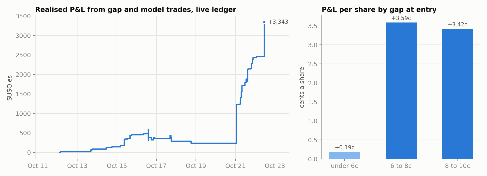

# Predictions Cup Bot

The trading system I built for the Susquehanna Predictions Cup, a play-money prediction market tournament on the 2026 US midterm elections. The same races traded on Kalshi with real money, so the bot treated Kalshi's prices as fair value and took any contest order that sat far enough away from them, then waited for the gap to close.

It traded live from October 11 to election night (November 3), starting from 100,000 play-money "SUSQies". No real money was involved.

## Results

- **Final account value: 120,718 (+20.7%).**
- October 11 to 25: 100,000 to 104,802, all realised, from 612 exits on 182,682 shares.
- Election night added 15,916, about 10,800 of it from the Maine Senate bet and the rest from the election-night engine.

## How it works

```
Kalshi public API     ->  fair value per contract (size-weighted mid of Kalshi's book, normalised per race)
contest realtime feed ->  collector.py  ->  SQLite (books, trades, Kalshi prices, leaderboard)
                                 |
                                 v
mm/engine.py, every few seconds
  gap takes    take any contest order at least 6c through fair value (fair value 0.10 to 0.90)
  model takes  contest_model.py predicts a 2c+ move in the next 24 h  ->  hold 24 h
  exits        a resting exit for every lot: target glides from 70% to 0% of the gap over 120 h
  risk         3k per take, 8k per race, 70k total (gaps of 8c+: 8k per take, 16k per race), 5k loss stop
  API budget   under 100 reads and 30 writes a minute
```

**Why a 6c threshold.** From the live ledger, by the size of the gap at entry:

| Gap at entry | Exits | P&L per share | Shares that made money |
|---|---|---|---|
| under 6c | 114 | +0.19c | 46% |
| 6 to 8c | 361 | +3.59c | 92% |
| 8 to 10c | 13 | +3.42c | 100% |



The exit route mattered too: lots that hit their resting target made +3.8c a share (86% of shares won, median hold 86 hours), while lots that ran into the 120-hour time stop made +0.6c.

A replay of every contest trade from October 10 to 22 through the engine's exit logic (`research/policy_grid.py`, 70k budget) agreed:

| Policy | P&L | Entries |
|---|---|---|
| live settings (6c edge, exit gliding 70% to 30%) | 11,202 | 3,176 |
| exit gliding to 0% instead | 11,515 | 3,440 |
| no time stop | 10,172 | 2,238 |
| 5c edge | 6,741 | 4,655 |
| 8c edge | 11,890 | 829 |
| fair value band 0.05 to 0.95 | 8,277 | 3,831 |

So on October 22 the threshold stayed at 6c, gaps of 8c or more were sized up to 8k a take and 16k a race, and the exit glide moved to 0%.

**The contest model** (`contest_model.py`) is a ridge regression of each contract's next-24-hour price move on its gap to Kalshi, how far that gap is from its 24 and 72-hour averages, the mismatch between the two parties' contracts in the same race, and short-term momentum. Walk-forward it made +0.5c per trade at about a 60% hit rate; live it was roughly flat (+230 over 118 exits).

**Market making** (`mm/quoter.py`, paper only). An Avellaneda-Stoikov quoter:
- leans its reservation price away from inventory;
- widens the half-spread with volatility and around scheduled events, and doubles it for 10 minutes after any sudden 2c Kalshi move;
- pulls quotes during debates.

It was simulated, never run live, and the result depends on who else is in the book:

| 48-hour paper run (`run_mm.py --paper`) | P&L | Fills | Edge at fill |
|---|---|---|---|
| against a tight house market maker | +625 | 130 | +0.81c a share |
| books priced only by students | +35,644 | 8,579 | +1.28c a share |

The second number rests on an assumed student order flow that couldn't be measured well, which is why the quoter never went live.

**Election night** (`mm/election.py`). From 5 pm ET:
- A race became eligible only once its state's polls closed.
- Races were tiered by Kalshi's fair value, held 60 to 120 seconds so one tick couldn't trigger anything:

  | Tier | Kalshi fair value | Required edge | Risk cap |
  |---|---|---|---|
  | called | 0.97 or more | 3c + Kalshi's half-spread | 30% of the 5 pm account value |
  | leaning | 0.85 to 0.97 | 6c + half-spread | 10% |
  | open | below 0.85 | 8c + half-spread | 5% |

  Edges doubled in slow-counting races.
- Called winners could be sold to fund better takes.
- A reversal breaker blocked any race whose called side fell back.

`tests/test_election.py` runs all of it on a scripted night.

**The final Senate bets.** On November 3, the contest and Kalshi both had Democrats at about 0.66 in Kansas and Maine, while a polls-only forecast had them near 75%. Limit buys capped at 0.70 filled 37,192 shares in Maine and none in Kansas. Democrats won Maine, for about +10,800.

## Hardware

The bot ran on my laptop instead of an always-on server, so sleep, Windows updates and power loss took it offline for much of the contest, and the results above come from a bot that wasn't running full time. A small cloud machine running the collector and the engine as services that restart on their own would remove that limit, and the engine already picks up its open positions when it starts.

## Things fixed along the way

- **Double count.** A fill reported twice was subtracted twice, letting one race exceed its cap. Fills now only count if they are newer than the last positions read (`tests/test_doublefill.py`).
- **Closed markets.** A closed Kalshi market shows bid 0 and ask 1, which read as a price of 0.50 and tripped the reversal breaker. Empty books are no longer read as prices (`tests/test_closed_market.py`).

## Running it

The engine is pure Python standard library; research and model scripts need numpy, pandas and scikit-learn (`pip install -r requirements.txt`). These run without any account:

```bash
cd bot
python run_mm.py --paper                  # 48 h market-making simulation
python tests/test_election.py
python tests/test_rules.py
python tests/test_tiers.py
python tests/test_doublefill.py
python tests/test_closed_market.py
```

Live trading (`run_mm.py --live`, `collector.py`, `trade.py`) needs a contest API key in `SM_API_KEY`, and the tournament is over. The recorded market data (about 2.4 GB) isn't included. Not affiliated with Susquehanna.

| Path | What it is |
|---|---|
| `bot/mm/engine.py` | the trading loop: fair values, takes, exits, risk limits, API budget |
| `bot/mm/election.py` | election-night mode |
| `bot/mm/fv.py`, `bot/kalshi.py` | Kalshi fair values |
| `bot/mm/quoter.py`, `paper.py`, `shadow.py` | quoting and the paper and shadow exchanges |
| `bot/contest_model.py` | the 24-hour contest price model |
| `bot/collector.py`, `bot/sm_client.py` | the recorder and the contest API client |
| `research/` | the live ledger and the policy grid |

Tested with Python 3.13.
